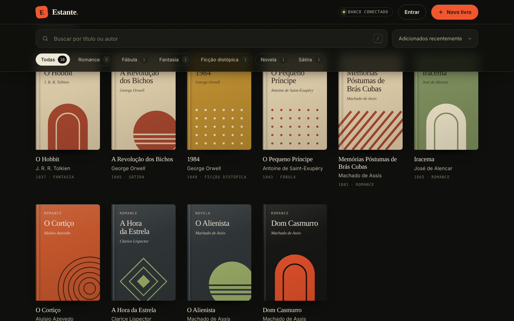

# Estante.

Catálogo de livros com **API REST em Node.js** e interface web própria. Os livros ficam num banco **PostgreSQL**; dá para buscar, filtrar por categoria, criar conta e cadastrar novos títulos.


## Tecnologias

| Camada | Ferramentas |
| --- | --- |
| Back-end | Node.js, Express 5, Sequelize, PostgreSQL |
| Front-end | HTML, CSS e JavaScript puro, sem framework |
| Segurança | Senhas salvas com hash (scrypt), nunca devolvidas pela API |

## Funcionalidades

- Catálogo com busca por título ou autor, filtro por categoria e ordenação
- Capas geradas por código para cada livro, com cor e padrão por categoria
- Painel de detalhes de cada obra
- Criar conta e entrar com e-mail e senha; só quem está logado cadastra livros
- Atalhos: `/` foca a busca, `N` abre o cadastro, `Esc` fecha painéis



## Rotas da API

| Método | Rota | O que faz |
| --- | --- | --- |
| GET | `/api` | Status da API |
| GET | `/api/livros` | Lista os livros |
| POST | `/api/livros` | Cadastra um livro (`nome` e `autor` obrigatórios) |
| GET | `/api/usuarios` | Lista os usuários, sem a senha |
| POST | `/api/usuarios` | Cria uma conta (e-mail único, senha com 6+ caracteres) |
| POST | `/api/usuarios/login` | Entra na conta |

Exemplo de cadastro de livro:

```json
{
  "nome": "Capitães da Areia",
  "autor": "Jorge Amado",
  "categoria": "Romance",
  "descricao": "Romance sobre meninos em situação de abandono em Salvador.",
  "editora": "José Olympio",
  "data_publicacao": "1937-01-01"
}
```

## Estrutura

Cada parte da interface tem a sua pasta, com o JS e o CSS juntos.

```
public/
  base/  hero/  filtros/  catalogo/  capas/  detalhes/
  cadastro/  conta/  toast/  api/  estado/  util/
src/
  config/database.js      conexão com o PostgreSQL
  models/                 livro.js, usuario.js
  controllers/            regras de cada rota
  routes/                 livroRoutes.js, usuarioRoutes.js
  seed/cadastrarLivros.js 10 livros iniciais
  server.js
```

## Como rodar

Pré-requisitos: Node.js 18+ e um banco PostgreSQL.

```bash
git clone https://github.com/miguelhenricoelho/estante.git
cd estante
npm install
cp .env.example .env    # preencha com os dados do seu banco
npm run seed            # cadastra os 10 livros iniciais
npm run dev
```

Abra **http://localhost:3000**. Para um banco local sem SSL, use `DB_SSL=false` no `.env`.

## Autor

**Miguel Henriques Coelho** · Ciência da Computação, Unifor
[GitHub](https://github.com/miguelhenricoelho) · [LinkedIn](https://www.linkedin.com/in/miguel-henriques-coelho-05686b3a7)
